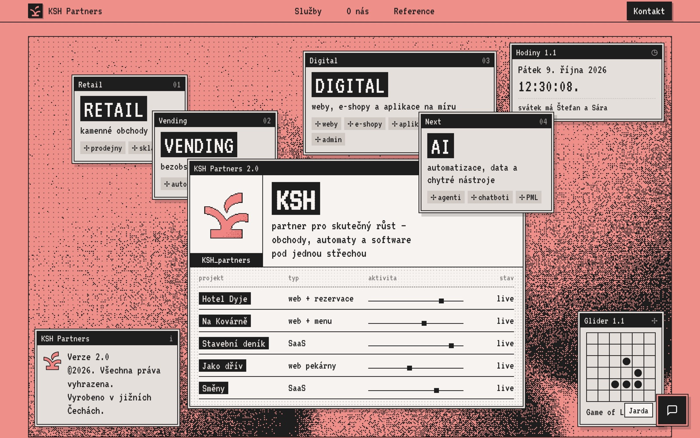

  
  
  

### `> whoami`

I co-run **[KSH Partners](https://ksh-partners.cz)**, a small Czech studio that does three things at once: we run physical stores, operate vending machines and build the software behind them. Most of my time goes into the digital side: websites, e-shops, admin panels and SaaS tools for real businesses, often ones we use ourselves first.

### `> ls ./work --live`

| Project | What it is | |
|---|---|---|
| **PML Systém** | POS, stock and compliance system for our own retail chain | [pml-system.cz](https://pml-system.cz) |
| **Hotel Dyje** | Hotel website with booking and a custom admin | [hoteldyje.cz](https://hoteldyje.cz) |
| **CEMA servis** | Agricultural machinery dealer: web + admin panel | [cemaservis.cz](https://cemaservis.cz) |
| **Revize Tábor** | Redesign for an electrical inspection company | [revize-tabor.cz](https://revize-tabor.cz) |
| **Směny** | Shift planning SaaS, in production with real teams | [sm-ny.vercel.app](https://sm-ny.vercel.app) |
| **Stavební deník** | Digital construction log (SaaS) | private |
| **Impastory** | E-shop for AI-painted oil wallpapers | [impastory.com](https://impastory.com) |

More references, including the projects we can't show here, are on **[ksh-partners.cz →](https://ksh-partners.cz/#reference)**

### `> cat stack.txt`

  
  
  
  
  
  
  
  
  
  
  
  

### `> open ksh-partners.cz`

